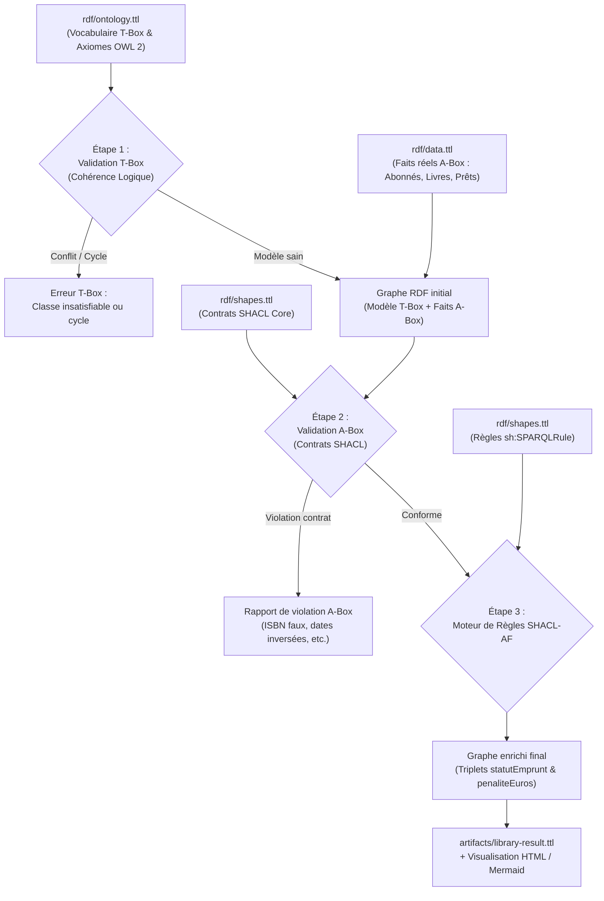
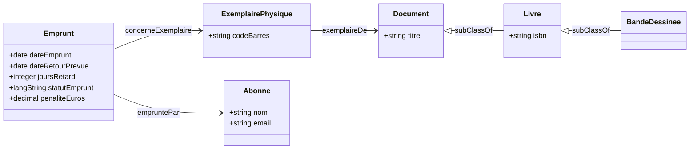

# Guide pédagogique : Découvrir OWL 2 et SHACL pas à pas

Ce guide est destiné à toute personne souhaitant comprendre concrètement le fonctionnement d'une ontologie sémantique et de règles de validation, sans aucun prérequis mathématique ou informatique complexe.

---

## 1. Le problème métier : Gestion des prêts en médiathèque

Dans notre médiathèque, trois abonnés ont chacun emprunté un document :

| Emprunt | Abonné | Document | Retard constaté | Statut attendu | Pénalité calculée (0.50 € / j) |
|---|---|---|---:|---|---:|
| `emprunt_alice` | Alice Dupont | *Astérix le Gaulois* | 0 jour | « en règle » | 0.00 € |
| `emprunt_bob` | Bob Martin | *Le Web Sémantique et les Ontologies* | 3 jours | « à relancer » | 1.50 € |
| `emprunt_claire` | Claire Bernard | *Le Web Sémantique et les Ontologies* | 10 jours | « critique » | 5.00 € |

Notre objectif est double :
1. **Valider le modèle conceptuel (T-Box)** et **valider contractuellement les données réelles (A-Box)**.
2. **Inférer automatiquement les statuts et pénalités** : enrichir le graphe avec de nouveaux faits sans modifier le code applicatif, uniquement grâce aux règles sémantiques.

---

## 2. Le cycle de vie des données



---

## 3. Comprendre le modèle sémantique : Œuvre vs Exemplaire

Une erreur classique des débutants consiste à confondre le **Livre intellectuel** (l'œuvre écrite par un auteur) et **l'Exemplaire physique** (l'objet matériel étiqueté qui se trouve sur une étagère).

- `ex:livre_ontologies` est l'œuvre. Elle possède un titre, un auteur et un ISBN.
- `ex:exemplaire_ont_1` et `ex:exemplaire_ont_2` sont deux objets matériels distincts qui représentent la même œuvre.
- Un emprunteur n'emporte pas chez lui l'« œuvre », il emporte un **exemplaire précis**, identifié par son propre code-barres.

### Diagramme du modèle (T-Box)



---

## 4. T-Box vs A-Box : Comprendre la frontière et les mécanismes de validation

Une des difficultés majeures dans l'apprentissage de l'ontologie est de comprendre **ce qui relève du modèle (T-Box)** et **ce qui relève des données (A-Box)**, ainsi que **la manière dont on valide chacun des deux niveaux**.

### Tableau comparatif fondamental

| Dimension | T-Box (Terminological Box) | A-Box (Assertional Box) |
|---|---|---|
| **Définition** | Le schéma conceptuel, le vocabulaire et les règles logiques du domaine. | Les données réelles, les faits observés, les individus et les transactions. |
| **Fichiers dans le projet** | `rdf/ontology.ttl` | `rdf/data.ttl` |
| **Éléments contenus** | `owl:Class`, `subClassOf`, `disjointWith`, `ObjectProperty`, `DatatypeProperty`, `TransitiveProperty`, `inverseOf`. | `ex:livre_asterix`, `ex:abonne_alice`, `ex:emprunt_bob`, leurs relations et dates. |
| **Qu'est-ce qui « casse » ce niveau ?** | Une contradiction logique interne, une classe impossible à instancier, un cycle d'héritage, un schéma non documenté. | Une donnée mal formée, un champ obligatoire manquant, une date incohérente, un rôle incompatible. |
| **Outil de validation** | **Raisonnement OWL / Vérificateur de cohérence sémantique** + Shapes de gouvernance métamodèle. | **SHACL Core** (contrats de données, formes fermées, contraintes relationnelles). |

---

### A. Comment vérifier que je ne casse rien lorsque j'ajoute des éléments à ma T-Box ?

Quand vous modifiez ou étendez le modèle conceptuel (par exemple, ajouter une nouvelle catégorie de document ou une nouvelle relation), vous devez vérifier **qu'aucune incohérence logique n'a été introduite**.

#### Exemple 1 : Une extension T-Box valide (sans casse)
Vous souhaitez ajouter les livres audio dans la médiathèque :
```turtle
ex:LivreAudio a owl:Class ;
    rdfs:subClassOf ex:Document ;
    rdfs:label "Livre audio"@fr ;
    rdfs:comment "Enregistrement sonore de la lecture d'un texte."@fr .
```
- Le raisonneur vérifie : `Document` n'est pas disjoint avec une autre classe parente.
- Aucun cycle n'est créé.
- Le validateur T-Box confirme : `MODÈLE COHÉRENT ET VALIDE`.

#### Exemple 2 : Une régression T-Box (casse logique / classe insatisfiable)
Supposons qu'un modélisateur crée par erreur une classe `LivreHybride` qui hérite à la fois de `LivreNumerique` et de `ExemplairePhysique` :
```turtle
ex:LivreHybride a owl:Class ;
    rdfs:subClassOf ex:LivreNumerique, ex:ExemplairePhysique .
```
Or, l'ontologie stipule explicitement :
```turtle
ex:LivreNumerique owl:disjointWith ex:ExemplairePhysique .
```
- **Conséquence logique :** Un individu ne peut pas appartenir à la fois à deux classes disjointes. La classe `LivreHybride` devient donc **logiquement impossible** (insatisfiable). En logique de description, elle équivaut à `owl:Nothing` (l'ensemble vide).
- **Comment le vérifier automatiquement ?**
  Le moteur exécute `validate_tbox_consistency()` (testé dans `tests/test_tbox_validation.py`) :
  ```text
  [ERREUR T-BOX] Classe insatisfiable: LivreHybride hérite de deux classes mutuellement disjointes (LivreNumerique et ExemplairePhysique).
  ```

#### Exemple 3 : Une régression T-Box par cycle d'héritage
Si quelqu'un écrit :
```turtle
ex:Document rdfs:subClassOf ex:BandeDessinee .
```
Comme `BandeDessinee` est déjà sous-classe de `Livre`, qui est sous-classe de `Document`, cela crée une boucle circulaire : `Document <|-- Livre <|-- BandeDessinee <|-- Document`.
- En logique OWL, les trois classes deviennent mathématiquement équivalentes, détruisant la hiérarchie.
- Le validateur T-Box intercepte immédiatement l'erreur :
  ```text
  [ERREUR T-BOX] Cycle d'héritage illégal détecté entre Document et BandeDessinee.
  ```

---

### B. Comment vérifier que je ne casse rien lorsque j'ajoute des données (A-Box) ?

Quand vous insérez de nouvelles données (un nouvel usager, un nouveau livre, un nouvel emprunt), la T-Box ne suffit pas à garantir leur intégrité, car OWL opère en **Monde Ouvert** (l'absence d'un champ n'est pas une erreur pour OWL). C'est le rôle de **SHACL Core**.

#### Exemple 1 : Un ajout A-Box valide (sans casse)
Vous ajoutez un abonné conforme :
```turtle
ex:abonne_nouveau a ex:Abonne ;
    ex:nom "David Martin" ;
    ex:email "david.martin@example.org" .
```
- Tous les champs obligatoires sont présents (`sh:minCount 1`).
- Le format d'email correspond au motif Regex.
- Aucune propriété parasite n'est présente (`sh:closed true`).
- Résultat : **CONFORME**.

#### Exemple 2 : Une casse A-Box sur format de données (ISBN)
Un agent saisit un livre avec un identifiant corrompu :
```turtle
ex:livre_errone a ex:Livre ;
    ex:titre "Titre test" ;
    ex:isbn "ABC-12345" .
```
- SHACL Core applique la forme `ex:LivreValidationShape` avec sa contrainte `sh:pattern "^97[89]-\\d{1,5}-\\d+-\\d+-[0-9X]$"`.
- pySHACL rejette l'insertion avec le message explicite :
  ```text
  [VIOLATION A-BOX] L'ISBN doit être unique et respecter la syntaxe internationale ISBN-13.
  ```

#### Exemple 3 : Une casse A-Box sur cohérence temporelle
Un emprunt est enregistré avec une date d'emprunt au 25 octobre et une date de retour prévue au 10 octobre :
```turtle
ex:emprunt_fou a ex:Emprunt ;
    ex:dateEmprunt "2026-10-25"^^xsd:date ;
    ex:dateRetourPrevue "2026-10-10"^^xsd:date .
```
- SHACL applique la contrainte relationnelle `sh:lessThan ex:dateRetourPrevue`.
- pySHACL signale immédiatement l'anomalie :
  ```text
  [VIOLATION A-BOX] La date d'emprunt doit être strictement antérieure à la date de retour prévue.
  ```

#### Exemple 4 : Une casse A-Box par violation de disjonction
Si un individu est déclaré à la fois usager abonné et auteur du catalogue :
```turtle
ex:usager_auteur a ex:Abonne, ex:Auteur ;
    ex:nom "Docteur Jekyll" .
```
- SHACL applique la forme `ex:AbonneDisjointWithAuteurShape` avec sa contrainte `sh:not [ sh:class ex:Auteur ]`.
- pySHACL bloque la saisie :
  ```text
  [VIOLATION A-BOX] Un abonné ne peut pas être simultanément déclaré comme auteur (classes disjointes).
  ```

---

## 5. Les règles d'inférence SHACL-AF décortiquées

Les règles du fichier `rdf/shapes.ttl` exploitent la syntaxe SPARQL `CONSTRUCT` pour générer de nouveaux triplets sur les données valides.

Analysons la règle pour les retards modérés (1 à 6 jours) :

```sparql
CONSTRUCT {
    $this <https://example.org/library#statutEmprunt> "à relancer"@fr .
    $this <https://example.org/library#penaliteEuros> ?penalite .
}
WHERE {
    $this <https://example.org/library#joursRetard> ?days .
    FILTER (?days > 0 && ?days < 7)
    BIND (xsd:decimal(?days) * 0.50 AS ?penalite)
}
```

1. **`$this`** : désigne l'emprunt actuellement examiné (par exemple `emprunt_bob`).
2. **`WHERE`** : cherche le nombre de jours de retard associé à cet emprunt (`?days` prend la valeur 3).
3. **`FILTER`** : vérifie que `3 > 0` et `3 < 7` (la condition est vraie !).
4. **`BIND`** : calcule la pénalité arithmétique : $3 \times 0.50 = 1.50$ €.
5. **`CONSTRUCT`** : crée deux nouveaux triplets et les ajoute au graphe :
   - `emprunt_bob ex:statutEmprunt "à relancer"@fr`
   - `emprunt_bob ex:penaliteEuros 1.50`

---

## 6. Synthèse des commandes de vérification

Pour vérifier votre projet au quotidien :

```bash
# Lancer l'intégralité des vérifications automatisées (T-Box + A-Box + Inférences)
pytest -v

# Vérifier uniquement que le modèle conceptuel (T-Box) n'est pas cassé
pytest tests/test_tbox_validation.py -v

# Vérifier uniquement que les données et contrats (A-Box) sont respectés
pytest tests/test_validation.py -v

# Exécuter le démonstrateur pédagogique complet
python -m library_owl_shacl_poc
```
