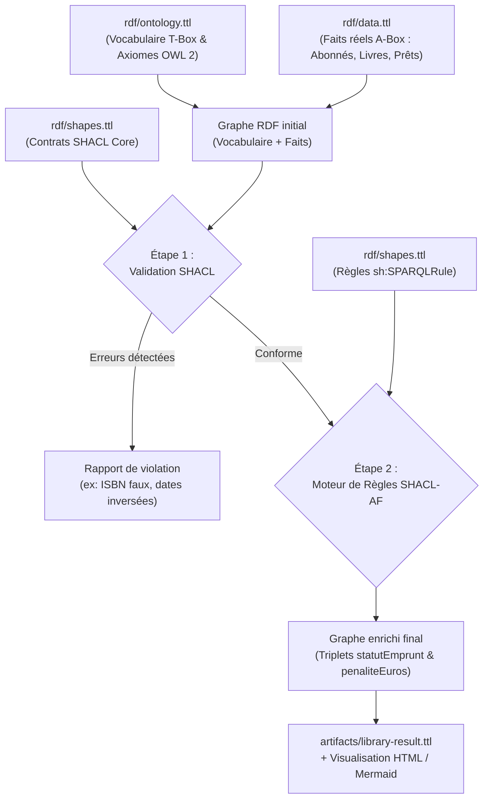
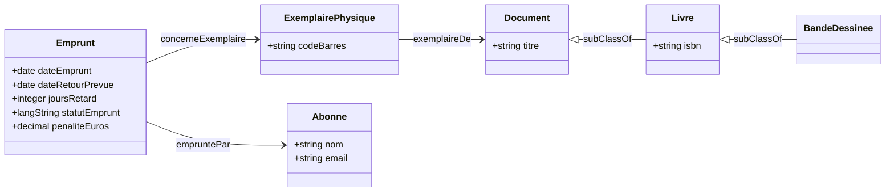

# Guide pédagogique : Découvrir OWL 2 et SHACL pas à pas

Ce guide est destiné à toute personne souhaitant comprendre concrètement le fonctionnement d'une ontologie sémantique et de règles de validation, sans aucun prérequis mathématique ou informatique complexe.

---

## 1. Le problème métier : Gestion des prêts en médiathèque

Dans notre médiathèque, trois abonnés ont chacun emprunté un document :

| Emprunt | Abonné | Document | Retard constaté | Statut attendu | Pénalité calculée (0.50 € / j) |
|---|---|---|---:|---|---:|
| `emprunt_alice` | Alice Dupont | *Astérix le Gaulois* | 0 jour | « en règle » | 0.00 € |
| `emprunt_bob` | Bob Martin | *Le Web Sémantique et les Ontologies* | 3 jours | « à relancer » | 1.50 € |
| `emprunt_claire` | Claire Bernard | *Le Web Sémantique et les Ontologies* | 10 jours | « critique » | 5.00 € |

Notre objectif est double :
1. **Valider contractuellement les données** : s'assurer qu'aucun document n'a un ISBN mal formé, qu'un emprunt ne commence pas après sa date de fin, et qu'un abonné n'a pas de données corrompues.
2. **Inférer automatiquement les statuts et pénalités** : enrichir le graphe avec de nouveaux faits sans modifier le code applicatif, uniquement grâce aux règles sémantiques.

---

## 2. Le cycle de vie des données



---

## 3. Comprendre le modèle sémantique : Œuvre vs Exemplaire

Une erreur classique des débutants consiste à confondre le **Livre intellectuel** (l'œuvre écrite par un auteur) et **l'Exemplaire physique** (l'objet matériel étiqueté qui se trouve sur une étagère).

- `ex:livre_ontologies` est l'œuvre. Elle possède un titre, un auteur et un ISBN.
- `ex:exemplaire_ont_1` et `ex:exemplaire_ont_2` sont deux objets matériels distincts qui représentent la même œuvre.
- Un emprunteur n'emporte pas chez lui l'« œuvre », il emporte un **exemplaire précis**, identifié par son propre code-barres.

### Diagramme du modèle (T-Box)



---

## 4. Les axiomes OWL 2 décryptés

Dans `rdf/ontology.ttl`, plusieurs axiomes logiques fondamentaux sont déclarés :

### A. La symétrie (`owl:SymmetricProperty`)
Si René Goscinny est co-auteur avec Albert Uderzo, un raisonneur OWL en déduit immédiatement la réciproque sans qu'il soit nécessaire d'écrire le triplet dans les deux sens :
```turtle
ex:coAuteurAvec a owl:SymmetricProperty .
```

### B. L'inversion (`owl:inverseOf`)
La relation entre une œuvre et son créateur fonctionne dans les deux sens :
```turtle
ex:aPourAuteur owl:inverseOf ex:aEcrit .
```
Dès lors que le graphe contient `livre_asterix aPourAuteur auteur_goscinny`, le raisonneur sait que `auteur_goscinny aEcrit livre_asterix`.

### C. La transitivité (`owl:TransitiveProperty`)
Le plan de classement documentaire classe les thèmes en cascade :
- *Web Sémantique & Ontologies* $\rightarrow$ thème parent : *Informatique*.
- *Informatique* $\rightarrow$ thème parent : *Sciences & Techniques*.

Grâce à `owl:TransitiveProperty` sur `ex:themeParent`, le système infère automatiquement que le livre d'ontologies relève également du domaine des *Sciences & Techniques*.

---

## 5. La validation SHACL Core pas à pas

Avant d'appliquer des règles de calcul, SHACL s'assure que les données sont fiables.

### Exemple 1 : Validation de l'ISBN (Expression régulière)
Le contrat SHACL `ex:LivreValidationShape` impose :
```turtle
sh:path ex:isbn ;
sh:pattern "^97[89]-\\d{1,5}-\\d+-\\d+-[0-9X]$" ;
```
Si un livre est saisi avec l'ISBN `"123-FAUX"`, le moteur pySHACL génère immédiatement un rapport de non-conformité et bloque la validation.

### Exemple 2 : Cohérence temporelle (`sh:lessThan`)
Un emprunt ne peut pas avoir une date de début postérieure à sa date de retour :
```turtle
sh:path ex:dateEmprunt ;
sh:lessThan ex:dateRetourPrevue ;
```
Si un opérateur saisit une date d'emprunt au 25 octobre et un retour prévu au 10 octobre, SHACL signale l'anomalie.

### Exemple 3 : Monde fermé sur les abonnés (`sh:closed true`)
Pour protéger le registre des usagers, aucun champ imprévu ne doit polluer les fiches :
```turtle
ex:AbonneValidationShape a sh:NodeShape ;
    sh:targetClass ex:Abonne ;
    sh:closed true ;
    sh:ignoredProperties ( rdf:type rdfs:label ) ;
```
L'ajout d'une propriété inconnue (comme `ex:proprieteInconnue`) est automatiquement rejeté.

---

## 6. Les règles d'inférence SHACL-AF décortiquées

Les règles du fichier `rdf/shapes.ttl` exploitent la syntaxe SPARQL `CONSTRUCT` pour générer de nouveaux triplets. 

Analysons la règle pour les retards modérés (1 à 6 jours) :

```sparql
CONSTRUCT {
    $this <https://example.org/library#statutEmprunt> "à relancer"@fr .
    $this <https://example.org/library#penaliteEuros> ?penalite .
}
WHERE {
    $this <https://example.org/library#joursRetard> ?days .
    FILTER (?days > 0 && ?days < 7)
    BIND (xsd:decimal(?days) * 0.50 AS ?penalite)
}
```

1. **`$this`** : désigne l'emprunt actuellement examiné (par exemple `emprunt_bob`).
2. **`WHERE`** : cherche le nombre de jours de retard associé à cet emprunt (`?days` prend la valeur 3).
3. **`FILTER`** : vérifie que `3 > 0` et `3 < 7` (la condition est vraie !).
4. **`BIND`** : calcule la pénalité arithmétique : $3 \times 0.50 = 1.50$ €.
5. **`CONSTRUCT`** : crée deux nouveaux triplets et les ajoute au graphe :
   - `emprunt_bob ex:statutEmprunt "à relancer"@fr`
   - `emprunt_bob ex:penaliteEuros 1.50`

---

## 7. Calcul manuel pour chaque cas du POC

1. **Cas d'Alice (`emprunt_alice`) :**
   - Retard constaté : `0 jour`.
   - Règle 1 s'active (`?days = 0`).
   - Nouveaux triplets : `statutEmprunt "en règle"@fr` et `penaliteEuros 0.0`.
2. **Cas de Bob (`emprunt_bob`) :**
   - Retard constaté : `3 jours`.
   - Règle 2 s'active (`0 < 3 < 7`).
   - Pénalité : $3 \times 0.50 = 1.50$ €.
   - Nouveaux triplets : `statutEmprunt "à relancer"@fr` et `penaliteEuros 1.50`.
3. **Cas de Claire (`emprunt_claire`) :**
   - Retard constaté : `10 jours`.
   - Règle 3 s'active (`10 >= 7`).
   - Pénalité : $10 \times 0.50 = 5.00$ €.
   - Nouveaux triplets : `statutEmprunt "critique"@fr` et `penaliteEuros 5.00`.
